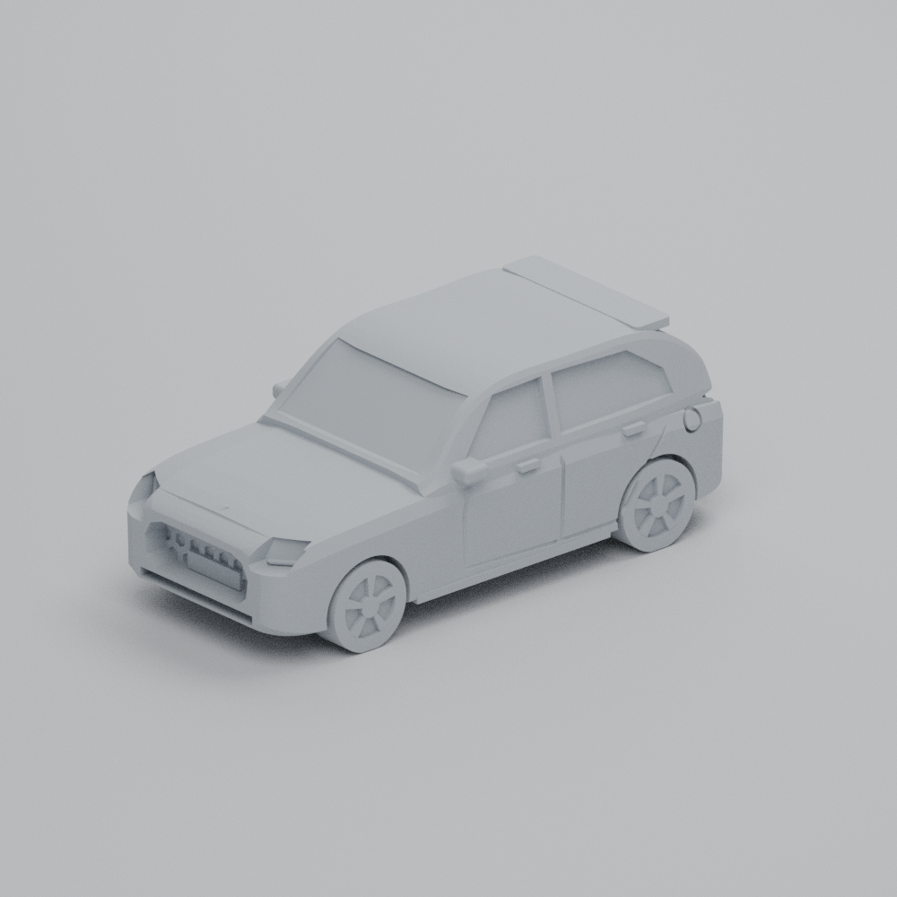
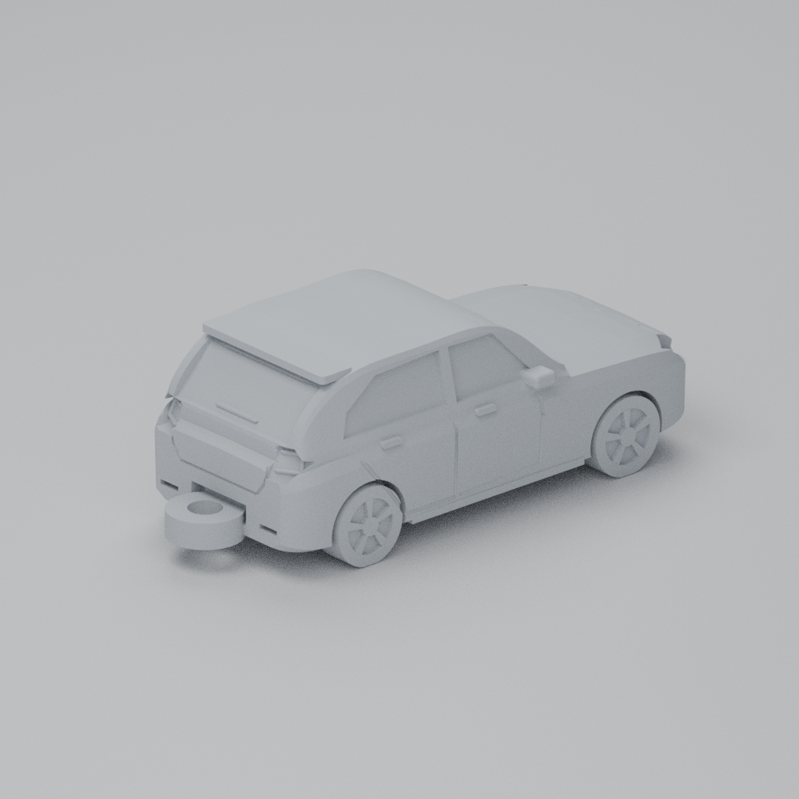

# Suzuki Swift Hybrid GLX Plus 2026 — llavero de 60 mm

Miniatura original de la carrocería que Suzuki Chile comercializa en 2026,
modelada con fotografías, vistas 360° y dimensiones de Suzuki. Una pieza,
ruedas fijas y sujeción trasera para argolla, para impresión FDM con PLA o PETG.

[**Descargar el proyecto completo (ZIP)**](https://github.com/andrewlopezmaureira/modelo-3d/raw/refs/heads/main/deliverables/suzuki_swift_hybrid_2026_llavero.zip)
· [Ver el STL en 3D](models/swift_hybrid_2026_60mm.stl)
· [Descargar 3MF](https://github.com/andrewlopezmaureira/modelo-3d/raw/refs/heads/main/models/swift_hybrid_2026_60mm.3mf)

Se reproduce la versión **GLX Plus**: llantas de aleación, spoiler corto y
faldón lateral. Se conservaron parrilla ovalada con panal, contorno de luces
diurnas, manillas traseras en las puertas, cristales, líneas de puertas y
pasos de rueda. Los relieves, espejos y unión están adaptados a impresión.
Es una interpretación de la carrocería real a escala pequeña; no es un CAD
de fábrica ni una réplica dimensional de cada panel o accesorio.

## Archivos

- [STL para laminado](models/swift_hybrid_2026_60mm.stl).
- [3MF con unidades milímetros](models/swift_hybrid_2026_60mm.3mf).
- [STEP editable en CAD](models/swift_hybrid_2026_60mm.step).
- [Parámetros](design.json) y [generador CAD](tools/build_swift.py).
- Vistas del modelo en previews; informes de validación digital en models.
- Paquete completo en deliverables/suzuki_swift_hybrid_2026_llavero.zip,
  con fuente, archivos editables, vistas y sumas SHA256 de integridad.

El 3MF contiene geometría, sin perfil de impresora ni G-code. La carpeta
models/attachment_sample contiene solamente una probeta de la sujeción,
que puedes usar para ensayar la argolla antes de imprimir el auto.

## Medidas

| Medida | Milímetros |
|---|---:|
| Largo del auto, sin sujeción | 60,00 |
| Largo total, con sujeción | 66,50 |
| Ancho nominal de carrocería | 26,97 |
| Ancho total, con espejos reforzados | 29,40 |
| Alto | 23,08 |
| Distancia entre ejes | 38,08 |
| Orificio para la argolla | 4,00 |
| Diámetro exterior de la sujeción | 9,00 |
| Espesor de la sujeción | 3,20 |
| Pared radial del orificio | 2,50 |

Escala de carrocería: **1:64,33**, desde la ficha oficial GLX Plus de
3860 × 1735 × 1485 mm. La sujeción no pertenece a la escala del auto.

## Impresión FDM

1. Abre el 3MF o importa el STL en **milímetros**, al 100% de escala.
2. Coloca el auto con las ruedas hacia la cama, como está orientado. Las
   ruedas tienen cuatro pequeñas superficies planas de apoyo.
3. Usa PETG para resistencia a golpes, o PLA para una impresión sencilla.
   Punto de partida: boquilla 0,4 mm, capas de 0,12–0,16 mm y cuatro perímetros.
   Una boquilla de 0,25–0,3 mm mejora los detalles del panal y los faros.
4. Activa soportes desde la cama bajo chasis, parachoques y sujeción; revisa
   en el laminador las zonas bajo espejos y spoiler. **Requiere soportes.**
   Usa un borde de adhesión de unos 4 mm si las ruedas no adhieren bien.
5. Empieza con 25–35% de relleno y un modificador al 100% en la sujeción y
   la zona de unión. Ajusta temperaturas y refrigeración según el filamento.
6. Revisa las capas: paredes del orificio, ruedas y relieves pequeños.
   Retira soportes con cuidado y prueba una argolla pequeña.

El agujero se comprueba en CAD y en secciones de la malla. El ajuste real y
la resistencia dependen del laminado y la impresión. **No se ha realizado
una prueba física.** Estas recomendaciones son una base, no un perfil
ensayado para una impresora específica.

## Referencias

- [Swift Hybrid, Suzuki Chile](https://www.suzuki.cl/vehiculo/swift-hybrid/).
- [Presentación GLX Plus, septiembre de 2026](https://www.suzuki.cl/blog/suzuki-suma-nueva-version-del-swift-hybrid/).
- [Ficha oficial](https://www.suzuki.cl/media/wmwl3mq3/suzuki_swift-hybrid_ficha-tecnica_web.pdf).
- [Swift y visor 360°, Global Suzuki](https://www.globalsuzuki.com/automobile/lineup/swift/).
- [Investigación del vehículo](references/vehicle-research.md).
- [Búsqueda de modelos existentes](references/existing-models.md).

El CAD es original. Las fotografías y otros materiales de Suzuki se usaron
como referencias de investigación y conservan su autoría. Sus enlaces están
en los informes; esos materiales no se incluyen en el repositorio publicado.

## Regenerar y comprobar

El entorno actual incluye Python 3.12, CadQuery 2.7.0, NumPy y Blender 4.3.2.
Usa el checkout existente en /workspace/modelo-3d.

~~~sh
cd /workspace/modelo-3d
python3 tools/build_swift.py
python3 tools/verify_stl.py models/swift_hybrid_2026_60mm.stl
python3 tools/verify_keyring_stl.py models/swift_hybrid_2026_60mm.stl --output models/keyring_validation.json
~~~

Para otra máquina, instala requirements.txt en un entorno virtual.
Blender es opcional para generar vistas:

~~~sh
blender --background --python tools/render_model.py -- models/swift_hybrid_2026_60mm.stl --output previews --samples 96 --save-blend previews/swift_hybrid_2026.blend --views front_3q rear_3q front rear side top
~~~

El generador comprueba el sólido CAD, el agujero, cierre y orientación del
STL y la importación del STEP. La limpieza de exportación elimina únicamente
triángulos de área exactamente cero, manteniendo límites y volumen.
La revisión independiente y sus tolerancias están documentadas en los
informes de models; no se ocultan errores ni se reparan agujeros silenciosamente.
